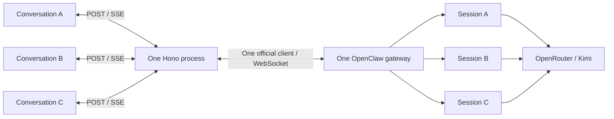

# OpenClaw chat

R1 runs one OpenClaw gateway container with OpenRouter and `moonshotai/kimi-k2-thinking`.
Use OpenClaw's built-in terminal client to talk to the agent.
The Hono backend and React interface run in a second container.
The frontend uses TypeScript, Vite, and plain CSS.

## Start

Install Docker Desktop with Linux containers and Node.js 22.19 or newer.
Use Bash for the commands below.

1. Put the separately supplied API key in `openrouter_key` at the repository root.
2. Prepare local files:

```bash
node scripts/setup.mjs
```

3. Build and start both services:

```bash
docker compose up -d --build --wait --wait-timeout 90
```

4. Pair the backend on its first start:

```bash
docker compose logs api
docker compose exec openclaw-gateway node dist/index.js devices list
```

Find the pending device named `Assessment Hono backend`.
Compare its device ID with the backend log.
Check that it requests only `operator.read` and `operator.write`.
Approve that exact request. Do not approve another device or use `--latest`.

```bash
PAIRING_REQUEST_ID='paste-the-reviewed-request-id'
docker compose exec openclaw-gateway node dist/index.js devices approve "$PAIRING_REQUEST_ID"
docker compose restart api
curl http://localhost:3000/ready
```

The result must be `{"status":"ready"}`.
`/health` checks the HTTP process only. It can pass before pairing.
Later starts reuse the saved device token.

5. Open [the chat interface](http://localhost:3000).
Create a conversation or select one from the sidebar.
Use the appearance switch to select the light theme.

6. Open the optional official terminal client:

```bash
docker compose exec openclaw-gateway node dist/index.js tui
```

In Git Bash, prefix that last command with `winpty` if Docker reports that the input is not a TTY.
Use the terminal client's session picker to select a saved conversation.
Press Ctrl+C twice to leave the terminal client.

Stop the services when finished:

```bash
docker compose stop
```

## Credentials and state

The real `openrouter_key` is local and ignored by Git and Docker builds.
Send it privately to reviewers alongside the repository.
Reviewers can also supply their own OpenRouter key.
The example file contains no credential.

Setup generates `.local/gateway_token`. It preserves an existing token.
Builds and containers use Node's built-in CA certificates by default.
No host certificate file is required.

Compose mounts credentials as secret files.
The gateway entrypoint copies its credentials into private temporary storage with mode 0600.
The gateway port is not published on the host.
Conversation history and configuration persist in the `gateway_state` volume.
The backend stores its own identity and scoped device token in `api_state`.
The provider key is mounted only in the gateway.
The backend receives the bootstrap gateway token as a secret file.
Its HTTP port is published only on `127.0.0.1:3000`.
Plain gateway WebSocket traffic stays inside the trusted local Compose network.
Do not use `docker compose down --volumes` to stop the application.

The configuration template is used only for new state.
Startup sets `agents.defaults.maxConcurrent` to 3 in saved configuration.
Later starts preserve the saved configuration.
The user-requested WSL memory cap remains 2 GB.

## Use the backend

Create a conversation. Copy its returned ID.

```bash
curl --json '{}' http://localhost:3000/api/conversations
CONVERSATION_ID='paste-the-returned-id'
REQUEST_ID=$(node -p "crypto.randomUUID()")
curl -N --json "{\"requestId\":\"$REQUEST_ID\",\"text\":\"Reply with a short greeting. Do not use tools.\"}" \
  "http://localhost:3000/api/conversations/$CONVERSATION_ID/messages"
```

Each valid message uses paid model credit.
Use a fresh request ID for each intended message. Never retry a POST automatically.
The stream emits `accepted`, visible `message` snapshots, `activity` snapshots, and one terminal event.
Replace displayed text with each snapshot. Do not append it.
A closed stream without a terminal event has an unknown outcome.
Read history before sending another message.

```bash
curl http://localhost:3000/api/conversations
curl "http://localhost:3000/api/conversations/$CONVERSATION_ID"
curl --json '{}' \
  "http://localhost:3000/api/conversations/$CONVERSATION_ID/runs/<runId>/cancel"
```

Cancellation acceptance does not prove the run stopped.
Read the terminal event or history to check its outcome.
Only application conversations appear in this API.
Empty conversations exist in memory until their first accepted message.
The backend permits three active application runs across separate conversations.
Each conversation permits one active run. Extra sends return 409.
An unresolved submission blocks later sends. Restarting is not a safe retry procedure.

Use `localhost` in these examples. Host and Origin checks reject other origins by default.
Set `APP_ORIGIN` for the intended application origin.
Set `DEV_ORIGIN` to one exact origin when using the Vite development server.
Do not expose this trusted single-user service publicly.

## Parallel conversations

Up to three application conversations can run at the same time through one gateway.
Each conversation maps to a separate OpenClaw session. Each session runs one turn at a time.
OpenClaw provides this scheduling through its [command queue](https://docs.openclaw.ai/concepts/queue).

### Architecture



The browser keeps a run controller and response stream for each conversation.
Changing the selected conversation does not stop observation of the other runs.
Hono reserves a run slot before its first asynchronous submission step.
A second send to the same conversation returns `409 RUN_BUSY`.
A fourth active or unresolved conversation returns `409 RUN_LIMIT`.
These rejected sends do not reach the model. The application does not queue them.

| Component | Responsibility |
| --- | --- |
| [Browser coordination](apps/web/src/chat.ts) | Keep separate run controllers, drafts, history reads, and recovery for each conversation |
| [Backend run tracker](apps/api/src/chat/runs.ts) | Reserve slots, reject duplicates, and route text and tool events to the correct run |
| [Gateway adapter](apps/api/src/openclaw.ts) | Keep subscriptions for all active conversations on one official client connection |
| [Backend recovery](apps/api/src/chat/recovery.ts) | Find active application sessions after reconnect and reconcile each run with gateway history |
| [Gateway startup](docker/configure-concurrency.mjs) | Set `agents.defaults.maxConcurrent` to 3 in new and saved configuration |

The backend and browser also enforce the limit of three in their code.
Changing only the gateway setting does not change the application limit.
One Hono process handles overlapping network requests. It does not start a process for each conversation.

### Why this needs more than a configuration change

The original application had one active-run slot and one browser run controller.
Its gateway adapter replaced the previous subscription when it subscribed to another session.
Parallel operation required changes to all three layers.

- **Admission must be atomic.** Pending submissions already consume capacity. Two requests must not reserve the same conversation while awaiting gateway acceptance. The backend enforces this across browser tabs.
- **Events can overlap.** Text and tool events must match the session and acknowledged run. Events can arrive before acceptance, so each pending run needs bounded buffers. Tool and chat sequence numbers are tracked separately.
- **Navigation must not own a run.** Each stream continues while another conversation is visible. A history read for one conversation must not overwrite a newer update or block recovery in another conversation.
- **Cancellation is asynchronous.** Stop targets one session and run. Its slot stays reserved until a terminal event or authoritative recovery confirms that the run ended. Completion can win the cancellation race.
- **Connection loss does not prove failure.** A dropped stream or lost acknowledgement can leave a paid request running. Recovery reads gateway state instead of repeating the message POST. Unknown submissions retain their slots. Unresolved gateway state can pause new sends across the application.
- **Saved configuration needs an update.** Editing the template alone affects only new state. The startup script applies the concurrency setting to the existing gateway volume and preserves the other settings.

The difficult part is keeping these states consistent while requests, events, reads, and reconnects finish in different orders.
The gateway already supports parallel sessions. The application must preserve correct routing and avoid duplicate work.

### Limits and verification

The three slots bound application submissions. They do not guarantee three simultaneous provider responses or a fixed speed increase.
Runs share the model provider, gateway resources, and agent workspace. Separate conversation histories do not isolate file changes made by tools.
The 2 GB WSL memory cap and container memory limits remain in effect.
Additional backend processes would need shared admission and run state to enforce one application-wide limit.

Controlled HTTP/SSE checks cover three concurrent streams, rejection of a fourth send, event isolation, cancellation, slot reuse, and recovery.
The running gateway setting and service health were checked. Three simultaneous paid model requests were not tested.
See the [verification record](docs/verification.md#parallel-conversations--2026-10-16).

## Tool activity and recovery

Expand an Activity row to see the tool name, safe file target, and result summary.
Each tool call has its own outcome. Failed calls remain visible after a later success.
Saved history restores activity. Raw tool output, credentials, and private reasoning are omitted.

Use OpenClaw's native agent loop and provider recovery. Tool errors return to the model, which can correct its next call.
Eligible provider failures use native recovery. The application does not repeat message POST requests.
The model can stop before a correction succeeds.
Existing tool permissions and run deadlines still apply.
See the official [agent loop](https://docs.openclaw.ai/concepts/agent-loop) and [retry policy](https://docs.openclaw.ai/concepts/retry).

The selected model still has unresolved tool-call failures. Real patch correction remains unverified.
See the [verification record](docs/verification.md#tool-activity-verification--2026-10-16) and [findings](docs/findings.md).

## Local code checks

```bash
npm ci --ignore-scripts
npm run check
npm test
npm run build
```

Use Node.js 22.19 or newer. The Docker image pins Node.js 22.23.3.
`npm run check` checks TypeScript, Oxlint, and Oxfmt.
`npm test` runs frontend HTTP/SSE integration checks and Hono static-serving checks with controlled responses.
These checks do not use paid model credit.
Credentials and local certificate files do not enter the Docker build context.

## Rendering choice

We use client-side rendering (CSR) for this local, interactive chat.
This keeps deployment simple: Hono serves a static Vite build.
The trade-off is that JavaScript must load before history appears.
Server-side rendering (SSR) could include initial history in HTML, while live chat would still need client logic.

## Frontend development

Use the Docker backend with the Vite development server.
Set the exact development origin when starting the API container:

```bash
DEV_ORIGIN=http://localhost:5173 docker compose up -d api
npm run dev
```

Open `http://localhost:5173`. Vite forwards `/api` and `/ready` to Hono.
If your network needs custom CA certificates, use the two Compose files from the next section with the same `DEV_ORIGIN` prefix.
Do not change the proxy Host or remove the backend Origin checks.
The production build runs through Hono on port 3000. It does not need a Vite server.

The interface tracks up to three active or unresolved runs across conversation navigation.
Send is paused in a busy conversation or when all three slots are in use. You can still edit drafts.
Stop requests cancellation. Wait for the confirmed outcome.
A lost stream recovers through history reads. The interface does not repeat message requests.
Only the theme is saved in browser storage. Drafts are lost on page refresh.

## Optional custom CA certificates

Use this only if your network requires a custom CA, such as an HTTPS inspection proxy.
Obtain a public PEM certificate bundle from your network administrator.
Save it in the ignored file `.local/custom-ca.pem`. Do not include private keys.
The setup script does not export host certificates.

```bash
export CUSTOM_CA_FILE=./.local/custom-ca.pem
docker compose -f compose.yaml -f compose.ca.yaml build --no-cache api
docker compose -f compose.yaml -f compose.ca.yaml up -d --build --wait --wait-timeout 90
```

Use both `-f` arguments for later Compose commands in this environment.
The override mounts the bundle at runtime and passes it as a temporary build secret for npm.
It does not copy certificates into image layers.
Use `--no-cache api` again after replacing the bundle because build-secret content does not invalidate cached build steps.
Keep TLS certificate verification enabled.
See [Docker build secrets](https://docs.docker.com/build/building/secrets/).

For npm commands on the host, set `NODE_EXTRA_CA_CERTS` to the absolute path of your PEM bundle.
Do this only in the terminal where you need the extra trust.

## Files

| File                           | Purpose                                                              |
| ------------------------------ | -------------------------------------------------------------------- |
| `compose.yaml`                 | Gateway and backend services, secrets, limits, and private state |
| `docker/Dockerfile`            | Pinned official gateway image and startup script |
| `docker/api.Dockerfile` | Pinned Node image and the backend build |
| `apps/api/src` | Controllers, middleware, chat components, types, and the gateway adapter |
| `apps/web/src` | Chat interface, HTTP/SSE client, run recovery, themes, and integration checks |
| `docker/openclaw.json`         | Provider, model, authentication, and agent settings                  |
| `docker/gateway-entrypoint.sh` | Prepare private secrets and seed initial configuration               |
| `scripts/setup.mjs`            | Prepare local credentials |
| `compose.ca.yaml` | Optional custom CA mounts for build and runtime |

The model uses the Responses API for visible streaming.
Tool definitions are supplied directly under the full tool profile.
Existing execution and service permissions still apply.
Provider tool-call compatibility remains an unresolved finding.

Read [requirements](docs/requirements.md) for the assessment scope and agreed tools.
Read [architecture](docs/architecture.md) for the current setup and future application design.
Read the [Hono backend PRD](docs/backend-prd.md) for the backend API and behavior.
Read the [React frontend PRD](docs/frontend-prd.md) for the interface requirements and acceptance checks.
Use [gateway operation](docs/gateway-operation.md) for restart and configuration notes.
Use [verification](docs/verification.md) for manual checks and application acceptance criteria.
Read [findings](docs/findings.md) for historical integration results and limitations.
